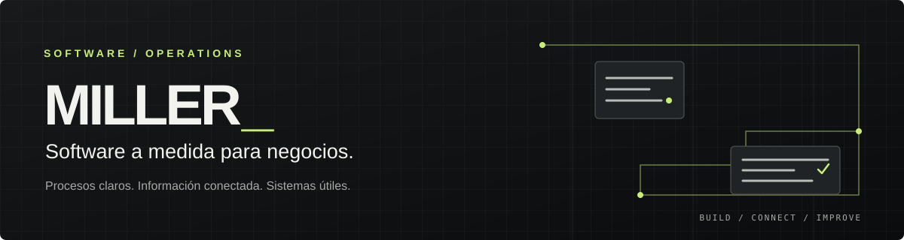
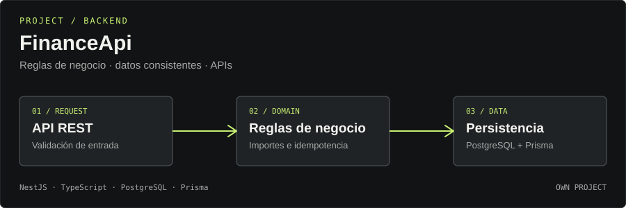
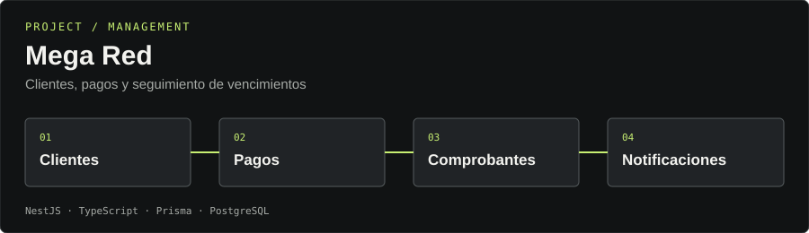

  

  
  
  

 

## ▍Software que se adapta al negocio

Soy Miler, desarrollador de software y responsable de **MILLER_**. Diseño y construyo soluciones digitales a medida para ayudar a los negocios a **organizar sus operaciones**, **conectar información** y **reducir tareas manuales**.

  

## ▍Cómo trabajo

Trabajo desde el problema operativo: primero entiendo el proceso y después defino qué solución tiene sentido construir.

  

## ▍Proyectos seleccionados

  

Caso práctico de una solución web progresiva orientada a las operaciones de un negocio de servicios automotrices. Aborda el seguimiento de vehículos y mantenimientos, productos e inventario, ventas, lavados, compras y cuentas por pagar.

> [!IMPORTANT]
> **Qué demuestra:** modelado de procesos de negocio, relaciones entre operaciones, gestión de inventario por movimientos y una interfaz pensada para el uso diario.
>  Caso presentado de forma anonimizada. Los datos reales del negocio no se publican.

 

  

API financiera desarrollada como proyecto propio para trabajar con reglas de negocio, persistencia y operaciones consistentes. Incluye manejo de importes en unidades enteras, snapshots de precios, idempotencia y mecanismos de renovación de sesión que deben evaluarse en el contexto de la implementación disponible.

> [!IMPORTANT]
> **Qué demuestra:** diseño de backend, modelado de datos, integridad de operaciones y atención a aspectos de seguridad.

  

 

  

Sistema de gestión para un proveedor de internet. Incluye gestión de clientes, pagos con vencimiento, comprobantes y notificaciones. El flujo genera documentos PDF tras completar pagos y revisa los pagos vencidos mediante una tarea programada.

  
  

## ▍Cómo puedo ayudar

  

No todos los negocios necesitan lo mismo. El alcance se define después de entender el proceso y validar la necesidad.

## ▍Experiencia profesional

  

Análisis de requerimientos operativos, definición de reglas de negocio, validación funcional mediante dispositivos PDA y digitalización de formatos de trabajo.

Esta experiencia forma parte de mi trayectoria profesional y no representa un proyecto de MILLER_.

## ▍Tecnologías

  

## ▍Hablemos de tu proceso

¿Tu negocio depende de hojas de cálculo, mensajes y tareas repetitivas? Cuéntame qué necesitas ordenar y evaluamos qué solución tiene sentido.

  

  
  

  
   
  <b>MILLER_</b> · Software a medida para negocios

